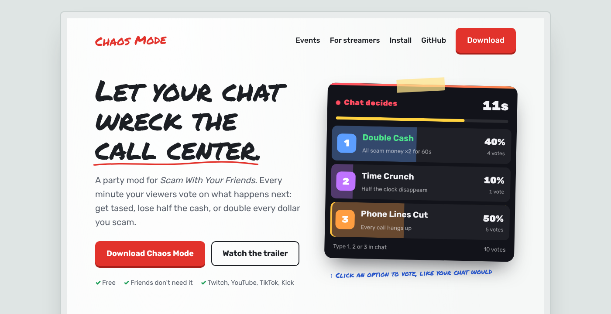

<p align="center">
  
</p>

<h1 align="center">Chaos Mode</h1>
<p align="center"><b>Let your chat wreck your call center.</b><br>
A party/streamer mod for <i>Scam With Your Friends</i>: random events, chat votes from Twitch, YouTube, TikTok and Kick, and an OBS overlay.</p>

<p align="center">
  <a href="../../releases/latest"><b>⬇ Download</b></a> ·
  <a href="#install">Install</a> ·
  <a href="#events">Events</a> ·
  <a href="#creator-mode-chat-votes">Creator Mode</a> ·
  <a href="#troubleshooting">Troubleshooting</a>
</p>

### ▶ [Watch the trailer](https://wcixv.github.io/chaos-mode/#trailer)

> Unofficial fan mod. Not affiliated with the game's developers. The game is in playtest, so updates can break mods.

---

## What it does

- **24 chaos events.** 16 punishments, 8 rewards, from getting tased to doubling every dollar you scam.
- **Chat decides.** Viewers type `1`, `2` or `3` to pick the next event. Votes run back-to-back.
- **Every platform.** Twitch is built in; YouTube, TikTok (via TikFinity) and Kick go through the ChatBridge app.
- **TikTok gifts.** Map gifts to events yourself. A Galaxy can end the day early, a Rose can rain money. See [TikTok gifts](#tiktok-gifts).
- **OBS overlay.** An animated vote widget you add as a Browser Source.
- **Friends don't need the mod.** Everything runs on the host and syncs through the game's own networking.
- **Private lobbies only.** Chaos Mode only works when you host a Friends Only or Invite Only lobby.

## Install

Chaos Mode runs on BepInEx. This game needs some fixed runtime files before BepInEx works, so there's a one-time setup first.

**1. Set up BepInEx (once)**

Use the community [Setup tool](https://github.com/swyf-modding/Setup). Download it (Code → Download ZIP), extract it, open PowerShell in that folder and run the line below with your own game folder. Run it again after game updates.

```
powershell -ExecutionPolicy Bypass -File .\setup.ps1 -GameDir "C:\...\steamapps\common\Scam With Your Friends Playtest"
```

**2. Install Chaos Mode**

1. Download **`ChaosMode-v1.2.2.zip`** and **`ChatBridge-v1.2.2.zip`** from [Releases](../../releases/latest).
2. In Steam: right-click the game → **Manage → Browse local files**.
3. Put **`ChaosMode.dll`** (from `ChaosMode-v1.2.2.zip`) in the **`BepInEx\plugins`** folder. Extract **`ChatBridge-v1.2.2.zip`** into the game folder so you have `ChatBridge\ChatBridge.exe`. To start it later, go to the game folder, open the `ChatBridge` folder and run `ChatBridge.exe`. Creator Mode (chat votes) stays locked until ChatBridge is installed.
4. Launch the game, host a **Friends Only** or **Invite Only** lobby and press **F2**.

**Coming from v1.0?** Delete `winhttp.dll`, `doorstop_config.ini`, the `ModLoader` folder and `Mods\ChaosMode.dll` from the game folder before step 1. The Setup tool leaves existing copies alone, and the old ones point at the v1.0 loader.

**Uninstall:** delete `ChaosMode.dll` from `BepInEx\plugins`, and the `ChatBridge` folder if you want it gone too.

## Events

| Punishments | | Rewards | |
|---|---|---|---|
| 🍺 **Drunk** | Everyone wasted for 30s | 💸 **Money Rain** | Everyone gets $150 |
| 💥 **Knockout** | Everyone hits the floor | 🎰 **Jackpot** | One player wins $750 |
| ⚡ **Tased** | Everyone gets tased | ⏰ **Overtime** | +60s on the clock |
| ⚡ **Taser Party** | Tased every 6s for 25s | 💼 **Payday** | $400 Scamazon money each |
| 🚀 **Launch** | Everyone gets yeeted | ✂️ **Quota Cut** | Quota −25% |
| 📵 **Phone Lines Cut** | Every call hangs up | 💰 **Double Cash** | All scam money ×2 for 60s |
| 📉 **Bankruptcy** | Team loses half its cash | ☕ **Boss On Break** | Clock frozen 30s |
| 🧾 **Tax Man** | Team loses 20% | 🎲 **Double or Nothing** | Team cash doubles… or vanishes |
| 👛 **Pickpocket** | Someone loses their shopping money | | |
| 😡 **Boss Is Furious** | Quota +50% | | |
| 😠 **Boss Is Angry** | Quota +20% | | |
| ⏳ **Time Crunch** | Half the clock disappears | | |
| 🚪 **Evacuation** | Everyone back to the entrance | | |
| 🔥 **You're Fired (jk)** | A very convincing fake firing | | |
| 🤝 **Huddle Up** | Everyone teleports to one player | | |
| 🔀 **Swap!** | Two players swap places | | |

Without Creator Mode, a random event fires every 30, 60 or 120 seconds. The F2 menu also lets you trigger any event yourself.

## Creator Mode (chat votes)

1. Make sure the `ChatBridge` folder is in the game folder (Creator Mode is locked without it), press **F2**, open the **Stream** tab and turn on **Chat votes** (Creator Mode).
2. **Twitch:** type your channel in the F2 menu and press **Connect**.
3. **YouTube / TikTok / Kick:** open `ChatBridge\ChatBridge.exe`, fill in your channels and press **START**.
   - TikTok uses **[TikFinity](https://tikfinity.com/)**. Keep it open and turn on its Event API.
4. Chat types **1**, **2** or **3**. The winner fires, then the next vote starts.

### TikTok gifts

With **TikTok gifts** switched on and ChatBridge connected to TikTok through TikFinity, gifts can fire events. The switch is on the **TikTok Gifts** tab of the F2 menu and is separate from **Chat votes**, so you can use gifts only, votes only, or both. Set the rules in the **F2 menu**, on the **TikTok Gifts** tab: type a gift name (or a diamond amount like `500`), pick an event with `<` `>` and press **Add this rule**. Change an existing rule with its `<` `>` buttons, or press **Delete**. Rules are saved in **`BepInEx\config\ChaosMode\gifts.txt`** in the game folder, in the game folder. They stay saved between games and through updates, so you only set them up once. You can also edit that file by hand any time, no restart needed (the menu keeps your comments):

```
Rose = MONEY RAIN
Finger Heart = DRUNK
Galaxy = END DAY
>= 5000 = JACKPOT
Doughnut = none
```

- `Gift name = EVENT` picks an event for one gift. Names are what TikTok calls them and aren't case sensitive.
- `>= 500 = EVENT` fires for any gift worth at least 500 diamonds. The biggest matching rule wins, and a gift's name rule beats it.
- `= none` turns a gift off.
- **`END DAY`** is a gift-only event that ends the workday right now. Any of the 24 regular events works too. The file lists them all.
- A gift combo fires once, when it ends. Gifts that arrive between days do nothing, and a gift storm is spaced out to one event every two seconds.

### OBS overlay

In ChatBridge, click **Copy** next to *OBS overlay*. In OBS, add a **Browser** source with that URL at **480 × 420**. Click **Preview** in ChatBridge to see a demo vote and a demo gift card while you position it. Turn off *Show vote box in game* in the F2 menu so viewers don't see the vote twice.

When a TikTok gift fires an event, the overlay pops up a card under the vote box showing who sent what and what it did. The cards also work with Chat votes off.

**TikTok LIVE Studio:** it refuses `localhost` links. Use `http://localtest.me:47801/overlay` instead (a name that always points back to your own PC; it needs an internet connection to look it up). ChatBridge prints this link in its window when it starts. In LIVE Studio, add a web link source and paste it.

## Your settings are remembered

Chaos Mode saves your timer, vote length, vote-box setting, Twitch channel and gift rules in `BepInEx\config\ChaosMode\` (`settings.txt` and `gifts.txt`). That folder is separate from the plugin and ChatBridge, so updating or reinstalling either one keeps everything. To back up your setup or move it to another PC, copy that folder.

## Troubleshooting

| Problem | Fix |
|---|---|
| Tased / Launch / Knockout do nothing | Turn **off** *Ragdoll Immunity* in the game settings |
| F2 says LOCKED | You must be the **host** of a **Friends Only** or **Invite Only** lobby |
| TikTok gifts do nothing | Open the **TikTok Gifts** tab in F2: it says what is missing (Chat votes off, ChatBridge too old, no rule for that gift) and shows the last gift received. Press **Test** next to a rule to try it. Make sure you extracted the newest ChatBridge zip, and send the gift while a workday is running |
| Windows warns about ChatBridge | *More info → Run anyway* (it isn't code-signed) |
| TikTok won't connect | Open TikFinity, log in and enable its Event API (port 21213) |
| Kick says "lookup blocked" | Put your `kickChatroomId` in `ChatBridge\chatbridge.json` |
| Something broke after a game update | Run the Setup tool again, then check `BepInEx\LogOutput.log` and `BepInEx\plugins\ChaosMode.log`. If it's still broken, open an issue |

## How it works

- **BepInEx:** loads the mod. This game's stripped Unity 6 runtime needs fixed files before BepInEx can start, which the community [Setup tool](https://github.com/swyf-modding/Setup) installs. (v1.0 used a tiny [UnityDoorstop](https://github.com/NeighTools/UnityDoorstop) loader instead; its source is still in `src/ModLoader`.)
- **ChaosMode.dll:** calls the game's own server functions (money, quota, clock, ragdolls, teleports), so every effect syncs to friends without them installing anything.
- **ChatBridge:** a small Windows app that reads stream chat and passes votes to the mod over `localhost:47800`. It also serves the OBS overlay on `localhost:47801`.

Build from source with `build.sh`. You'll need the .NET SDK, Mono and Node 22, plus `GAME_MANAGED` pointing at your game's `..._Data/Managed` folder. The game's DLLs aren't included in this repo.

## License

MIT for this project's code. The release zip only has this project's files. BepInEx and UnityDoorstop (both LGPL-2.1) come from the Setup tool.
